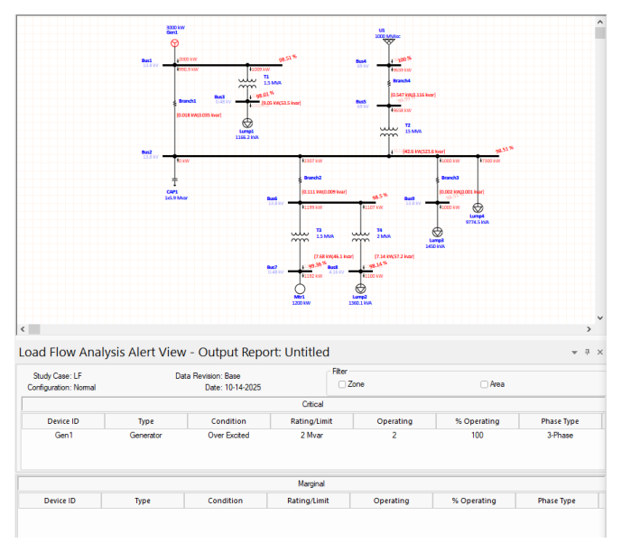
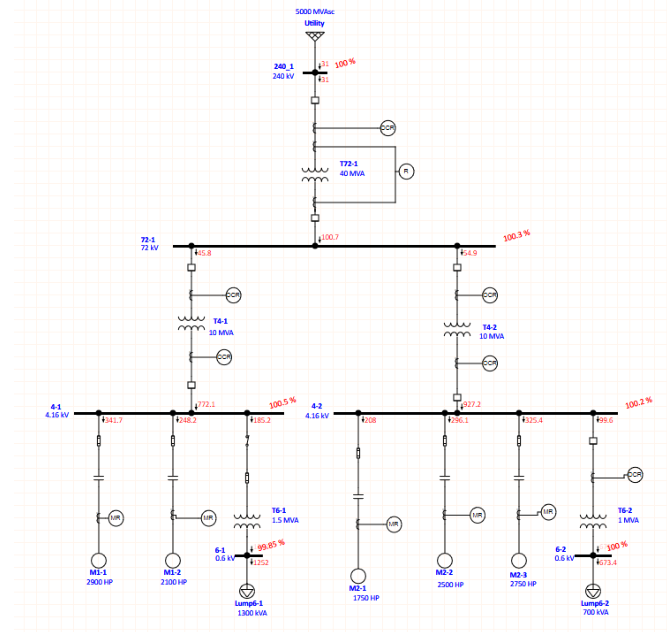
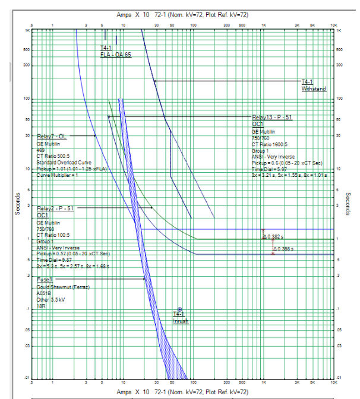
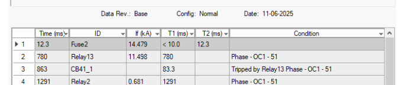

# Industrial power system protection studies in ETAP

Load flow, overcurrent coordination, and short-circuit studies for two industrial systems, run in ETAP 24 and checked by hand where the model could be reduced to a circuit.

This is group coursework from **ENEL 586, Power System Protection** (University of Calgary, Fall 2025). The networks and equipment data were specified for the course. The work below is the modelling, the settings, and the checks we did on those systems.

**Team:** Md Shadman Sakib, Hasnan Siddique Sunve, Md Rafiu Hossain

## What is in here

| Study | System | Result that mattered |
| --- | --- | --- |
| Load flow | 9-bus industrial plant, 69 / 13.8 / 4.16 / 0.48 kV | Two transformers were overloaded. Rerating them cleared the transformer and bus alerts. |
| Coordination | 240 / 72 / 4.16 / 0.6 kV substation with large motors | Phase overcurrent relays, motor relays, fuses, and a transformer differential set so a motor fault clears from the fuse outward. |
| Short circuit | Plant model, utility at 1200 MVA | Fault current, motor contribution, transformer impedance, and neutral grounding checked against hand calculations. |

The early ETAP exercises (drawing a one-line, reading alert colours, swapping a cable) were practice with the tool. They are not written up here.

ETAP is a trademark of Operation Technology, Inc. The course lab manual is not in this repository.

## 1. Load flow on a nine-bus plant

The plant is the kind of network used in IEEE industrial-system examples. A 69 kV utility (1000 MVA, X/R = 22.2) feeds a 13.8 kV bus through a 15 MVA transformer. A generator holds voltage on the 13.8 kV system. Loads sit at 13.8 kV, 4.16 kV, and 480 V, with a 5.9 Mvar capacitor bank on the 13.8 kV bus.

Bus types follow from what is specified at each bus:

| Bus | Known quantities | Type |
| --- | --- | --- |
| Utility bus (Bus 4) | Voltage and angle | Slack |
| Generator bus (Bus 1) | 2000 kW, 0.995 pu | PV |
| Every other bus | Load power, or neither P nor V controlled | PQ |

Apparent power leaving the 69 kV bus was checked with \(S = \sqrt{3}\,VI\). At 69 kV and 83.1 A that is 9.93 MVA, which agreed with the load-flow result.

On the first design-load run, T4 was at 1.36 MVA on a 1.25 MVA rating (109%) and T3 was at the top of its 1.25 MVA rating. T3 was raised to **1.5 MVA** and T4 to **2 MVA**. After that, the transformer overload and bus undervoltage alerts were gone. The generator stayed on its **2 Mvar** excitation limit, so the reactive limit was still binding.

## 2. Overcurrent coordination of an industrial substation

The second model is a motor-heavy substation:

- Utility: 240 kV, 5000 MVA, X/R = 20
- T72-1: 240 / 72 kV, 40/50 MVA
- T4-1 and T4-2: 72 / 4.16 kV, 10/12.5 MVA, each with a 25 A neutral grounding resistor
- T6-1 and T6-2: 4.16 / 0.6 kV, 1.5 MVA and 1.0 MVA, each with a 5 A neutral grounding resistor
- Motors from 1750 hp to 2900 hp at 4 kV, plus 1300 kVA and 700 kVA loads at 600 V

Protection on each motor feeder is a GE Multilin 469, tripping the contactor, in series with a Gould Shawmut medium-voltage fuse. The fuse takes the high-current faults. The relay takes overload and the lower fault currents, on the left side of the point where the two curves cross. Upstream feeders use GE Multilin 750/760 phase overcurrent elements. The main transformer also has a GE Multilin 745 differential, which trips the 240 kV and 72 kV breakers for a fault inside its zone. Differential does not have to grade with the overcurrent curves, because its zone is bounded by its CTs. The 745 phase overcurrent element was then set as a duplicate of the upstream overcurrent relay, so the transformer still has timed backup if the differential is out of service.

Phase overcurrent settings used the load-flow current as the starting point, an ANSI very-inverse curve, and a coordination time of about 0.3 to 0.5 s to cover breaker opening and relay reset. Curves were kept below the transformer damage curve and above the inrush point. On the 4.16 kV feeder plotted below, the time gaps marked on the curve are **0.28 s** and **0.39 s**.

A three-phase fault on the 2100 hp motor (M1-2) was run in the sequence viewer to confirm the curve. The fuse sees 14.5 kA and operates in 12 ms. Relay 13 sees 11.4 kA and operates at 780 ms, and its breaker is open 83 ms later. Relay 2, on the 72 kV side of the transformer, sees 0.68 kA and operates at 1.29 s. The margin from the fuse to Relay 13 is 0.77 s. The margin from Relay 13 to Relay 2 is 0.43 s, in the 0.3 to 0.5 s band used on the curve. The 72 kV relay current is smaller because it is on the high-voltage side of T4-1.

## 3. Short-circuit study

Balanced faults were placed on three buses of the plant model. Current is highest at the bus downstream of the step-down transformer, where the voltage is lower and a motor is connected.

| Faulted bus | Three-phase fault current |
| --- | --- |
| Bus 1 | 10.57 kA |
| Bus 2 | 10.87 kA |
| Bus 3 | 40.15 kA |

The utility is given as 1200 MVA. Its own contribution at 69 kV is

\[
I = \frac{1200\,\text{MVA}}{\sqrt{3}\times 69\,\text{kV}} = 10.04\,\text{kA}, \qquad Z_\text{th} = \frac{(69\,\text{kV})^2}{1200\,\text{MVA}} = 3.97\,\Omega.
\]

ETAP’s fault at Bus 1 is 10.57 kA. The difference is the rest of the network, including machines, on top of the utility Thevenin source.

At Bus 1 the three-phase fault was also the largest of the four fault types. A line-to-ground fault has to flow through the zero-sequence path, and a line-to-line fault does not use all three phases.

| Fault at Bus 1 | Symmetrical current |
| --- | --- |
| Three-phase | 10.57 kA |
| Line-to-ground | 10.48 kA |
| Line-to-line | 9.15 kA |
| Double line-to-ground | 10.52 kA and 10.53 kA on the faulted phases |

The line-to-ground value was recomputed from the sequence impedances in the ETAP short-circuit report (\(Z_1 = 3.77\,\Omega\), \(Z_2 = 3.77\,\Omega\), \(Z_0 = 3.86\,\Omega\), pre-fault voltage 69 kV):

\[
I_f = \frac{3\,V_{LN}}{Z_1 + Z_2 + Z_0} = 10.48\,\text{kA}.
\]

That matches the program. Adding fault impedance on a separate line-to-ground run reduced the current from 9.32 kA at a bolted fault to 1.62 kA at \(15 + j15\,\Omega\). That run did not start from the same 10.48 kA case, so the two bolted numbers are from different study cases. The trend is the same: fault current falls as fault impedance rises.

### Motor contribution

Replacing the motor at Bus 3 with a passive load removes the subtransient current the motor feeds into the fault for the first few cycles.

| Model at Bus 3 | Three-phase fault current |
| --- | --- |
| Induction motor | 40.15 kA |
| Lumped load, as modelled | 35.44 kA |
| 100% constant kVA | 36.82 kA |
| 100% constant impedance | 29.97 kA |

A constant-impedance load draws current and does not act as a source. A constant-kVA model behaves more like a motor, so more of the fault current comes back.

### What changes the fault level

- Dropping the utility short-circuit level from 1200 MVA to 600 MVA raises the utility Thevenin impedance and lowers the balanced fault current at Bus 1.
- At Bus 6, cutting the transformer impedance from 11.5% to 5.75% raised the balanced fault current from **19.4 kA to 32.8 kA**.

### Neutral grounding resistor

A neutral grounding resistor limits ground-fault current and leaves balanced faults alone, because a three-phase fault does not need the neutral path.

| Quantity | Solidly grounded | 2.5 A NGR |
| --- | --- | --- |
| Normal primary current | 73 A | 73 A |
| Contribution to a balanced fault | 6.63 kA | 6.63 kA |
| Contribution to a line-to-ground fault | 7.74 kA | 2 A |

ETAP reported 3187 Ω for the 2.5 A resistor. With a secondary line-to-neutral voltage of 7.97 kV, a resistor sized to hold a bolted ground fault to 5 A is \(7.97\,\text{kV} / 5\,\text{A} = 1593\,\Omega\).

## Scope

These are course studies of assigned networks, completed as a group of three. They use the same studies a protection engineer runs on a plant: load flow for pickup current and equipment loading, time-current curves for grading, a sequence-of-operation check, and a short-circuit case checked from the sequence network. They are not a design for a utility customer.
